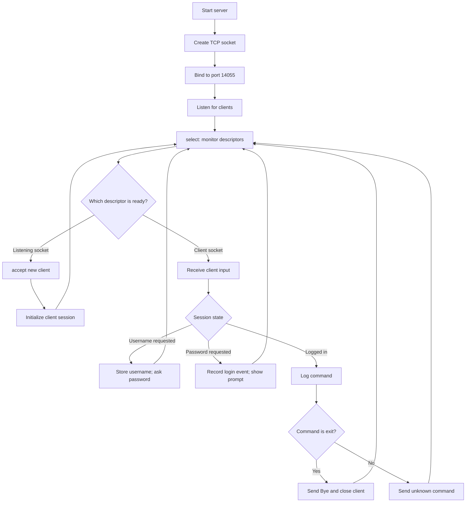

# Architecture

## Overview

The lab daemon is a single-process TCP server. It monitors the listening socket and active client sockets with `select()`, allowing it to service multiple clients without creating one thread per client.

## Connection lifecycle

1. Create an IPv4 TCP socket.
2. Bind it to all local interfaces on the configured lab port.
3. Start listening for incoming connections.
4. Use `select()` to monitor the listener and connected client sockets.
5. Accept each new connection and initialize per-client state.
6. Read client input and progress through username, password, and logged-in states.
7. For logged-in sessions, log the received command; close the connection for `exit`, otherwise reply `unknown command`.

## Important implementation notes

- The lab version uses a fixed-size client table (64 entries) indexed by socket descriptor. This should be revisited before reuse because file descriptors are not inherently guaranteed to fit within an application-defined client array.
- Robust production code should check all system-call return values and handle partial sends, input framing, descriptor limits, and abnormal disconnects.
- Passwords must never be written to logs in a secure implementation.
